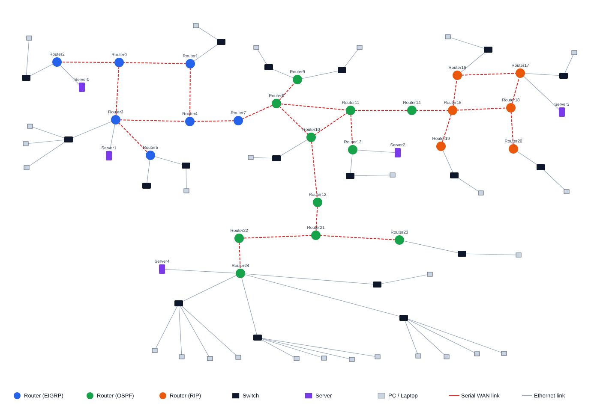

# Enterprise Network Design in Cisco Packet Tracer

A multi-site enterprise network designed and simulated in **Cisco Packet Tracer 6.2** as the final project of my Computer Networks course at FAST-NUCES (grade A).

The network connects several sites through serial WAN links, runs **three routing protocols** (EIGRP, OSPF and RIP) that exchange routes through **redistribution**, and provides **centralized DHCP**, **access control lists** and **NAT**.



## At a glance

| | |
|---|---|
| Devices | 75 (24 Cisco 2811 routers, 18 Catalyst 2960 switches, 5 servers, 28 PCs and laptops) |
| Links | 77 (26 serial WAN links, 51 Ethernet links) |
| Address space | 122.5.0.0, subnetted with VLSM from /30 to /19 |
| Routing | EIGRP AS 24, OSPF process 10 (areas 0 and 1), RIPv1 |
| Services | DHCP with 20 pools on 2 servers, standard ACLs, static NAT |

## Design

### 1. Addressing (VLSM)
Every subnet is sized to its needs:
- **/29** for the serial point-to-point WAN links between routers
- **/30** for router-to-server links
- **/19 to /23** for user LANs, depending on the number of hosts in each site

The full list of interfaces and subnets is in [addressing.md](addressing.md).

### 2. Routing: three domains
| Domain | Protocol | Routers |
|---|---|---|
| West | EIGRP AS 24 | Router0 to Router5, Router7 |
| Centre and south | OSPF process 10, area 1 and backbone area 0 | Router7 to Router14, Router21 to Router24 |
| East | RIP | Router14 to Router20 |

**Router7** (EIGRP and OSPF) and **Router14** (OSPF and RIP) are border routers. They redistribute routes in both directions, so every host can reach every other site:

```
! Router7
router eigrp 24
 redistribute ospf 10 metric 10000 10 255 255 1
router ospf 10
 redistribute eigrp 24 subnets

! Router14
router ospf 10
 redistribute rip metric 5 subnets
router rip
 redistribute ospf 10 metric 1
```

OSPF is split into **area 1** and the **backbone area 0**, with Router12 as the area border router.

### 3. Centralized DHCP
Two servers hold all the address pools (15 on Server0, 5 on Server4). Each LAN gateway forwards DHCP requests to them with `ip helper-address`, so no router needs its own DHCP configuration.

### 4. Security with ACLs
Standard access lists on the LAN-facing interfaces block traffic from specific server subnets into user networks, for example:
```
access-list 1 deny 122.5.187.40 0.0.0.3
access-list 1 permit any
interface FastEthernet0/1
 ip access-group 1 out
```

### 5. NAT
Router17 connects a private network (192.168.1.0/24) to the rest of the network with **static NAT** and default routes over two serial links.

## Repository contents
| File | Description |
|---|---|
| `enterprise_network.pkt` | The Packet Tracer project. Open it with Cisco Packet Tracer 6.2 or later. |
| `configs/` | Running configuration of each of the 24 routers |
| `addressing.md` | Interface and subnet table generated from the configs |
| `topology.png` / `topology.svg` | Topology diagram |

## How to open
1. Install [Cisco Packet Tracer](https://www.netacad.com/courses/packet-tracer) (a free account on Cisco Networking Academy is needed).
2. Open `enterprise_network.pkt`.
3. Test connectivity with `ping` from any PC, or follow packets in **Simulation** mode.

## Skills shown
IPv4 subnetting (VLSM) · EIGRP · OSPF multi-area · RIP · route redistribution · DHCP relay · ACLs · NAT · Cisco IOS CLI
